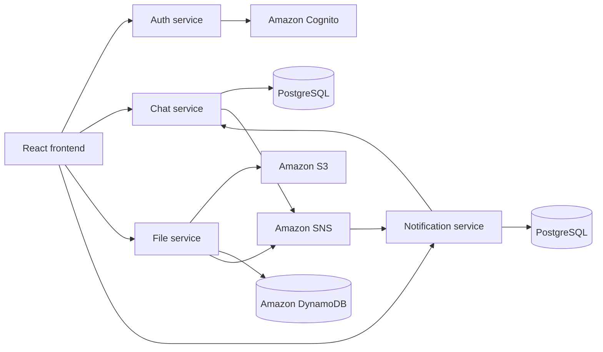

# Chat Microservices

A chat application for conversations, file sharing, and notifications. The backend is organized into independent microservices and uses AWS services for authentication, storage, and event-driven communication.

## Features

- User registration and login with Amazon Cognito
- Chat creation, messaging, and conversation history
- File uploads and downloads within chats
- Notifications for new messages and shared files
- Notification history in the web application

## Architecture



The backend consists of four Spring Boot services:

| Service | Responsibility |
| --- | --- |
| `auth-service` | Registration, login, and user lookup through Cognito |
| `chat-service` | Chats and messages stored in PostgreSQL |
| `file-service` | File handling in S3 and metadata in DynamoDB |
| `notification-service` | SNS event handling and notification history in PostgreSQL |

## Technology

- **Frontend:** React 18, Vite, Nginx
- **Backend:** Java 17, Spring Boot 3, Maven
- **Databases:** PostgreSQL, Amazon DynamoDB
- **AWS:** Cognito, S3, SNS, ECS/Fargate, RDS, Application Load Balancer
- **Local environment:** Docker Compose, LocalStack
- **Infrastructure:** Terraform

## Project structure

```text
frontend/                 React web application
services/
  auth-service/           Authentication and users
  chat-service/           Chats and messages
  file-service/           Files and metadata
  notification-service/   Notifications
terraform/                AWS infrastructure configuration
docker-compose.yml        Local environment configuration
init-aws.sh               LocalStack resource initialization
```

## Local development

Docker with Docker Compose is required. The repository includes configuration for the services, PostgreSQL, and LocalStack.

```bash
docker compose up --build
```

The frontend is available at `http://localhost:5173`, and the backend services use ports `8080`–`8083`. A complete local setup requires Cognito, database, JWT, and AWS/LocalStack settings, as well as the frontend API URLs (`VITE_*_API`).

## Tests

Unit tests cover Cognito registration response mapping, chat participant handling and message authorization, file metadata mapping, and SNS notification delivery to other chat participants. Run the tests for a service from its directory:

```bash
cd services/chat-service
mvn test
```

The same command can be run from `services/auth-service`, `services/file-service`, and `services/notification-service`. The frontend production build can be checked with `npm run build` from the `frontend` directory.

## API

| Service | Endpoints |
| --- | --- |
| Auth | `POST /auth/register`, `POST /auth/login`, `GET /auth/me`, `GET /auth/resolve` |
| Chat | `GET/POST /chats`, `GET/POST /chats/{chatId}/messages` |
| Files | `GET/POST /files`, `GET /files/{fileId}`, `GET /files/{fileId}/download` |
| Notifications | `GET /notifications/messages`, `GET /notifications/files` |

Most user-facing endpoints require a Cognito access token. Each service also exposes a health check endpoint at `/health`.

## AWS infrastructure

The Terraform configuration in `terraform/` describes the AWS resources used by the application, including ECS/Fargate clusters, load balancers, RDS databases, Cognito, S3, DynamoDB, and SNS. Deployment requires service images in a container registry, AWS credentials, and environment-specific variable values.
